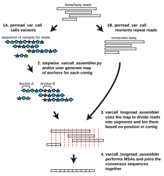

# varcall_longread_assembler
 A Snakemake pipeline for assembling repeat regions using long DNA sequencing reads

## Introduction
Long-read sequencing, such as Oxford Nanopore Technologies (ONT) and Pacific Biosciences' SMRT/HiFi, has vastly improved our ability to assemble complete genomes.  However, even the longest reported reads from these methods are typically insufficient to span repeat regions commonly found within eukaryotic genomes, for example 45S/48S gene, 5S gene, and pericentromeric repeats.  While there are often polymorphisms among repeat copies, the inaccuracy of ONT can limit their usefulness for assembly, while HiFi is restricted to much shorter read lengths.  Yet, repeat regions may have variants in the form of groups of SNPs, VNTRs, indels, or other identifiable landmarks that are missed by standard long read assemblers but contain sufficient information to allow assembly and can be recognized in long ONT reads.

This pipeline uses existing tools and custom scripts to generate a consensus sequence from long reads that are aligned to one another based on variant calls.  The main pipeline performs the consensus sequence steps of assembly, but not the overlap/assembly graph building from variant called reads.  The pipeline first requires the user to identify feature variants and then perform variant calling through its sister pipeline `perread_var_call` (https://github.com/drfultz/perread_var_call), which yields a `.feat` file containing the sequence-of-variants at each repeat-unit for each read.  The user then generates a map of unique sequence-of-variants anchors manually and/or with the use of the included `tools/stepwise_varcall_assembler.py`.  (This step is equivalent to building an assembly graph but at the sequence-of-variants level)  Once this map of unique anchors is created, `varcall_longread_assembler` gathers reads that contain these anchors and partitions segments of the individual reads into groups at each repeat unit.  This forces repeat unit sequences to align with their proper partners, not distant units, in order to generate a consensus sequence of each repeat.  These consensuses are then simply concatenated together in order.

**This pipeline is not aware of repeat orientation and therefore can only be used for repeat regions where units largely face one direction.**  A second version of this pipeline, which handles more complex repeat region structures, is in development.

An earlier version of this pipeline, `tagged_longread_assembler`, which used DNA sequence tags for read placement, generated the first near-complete assembly of the _A. thaliana_ NOR/rDNA regions (https://www.science.org/doi/full/10.1126/sciadv.adj4509), and this sequence is now included in the [reference genome (Col-CC/TAIR12)](https://phoenixbioinfo.org/announcing-the-publication-of-tair12-consult-the-fully-reannotated-genome-on-the-european-nucleotide-archive/).



## Getting started
The pipeline is designed to be run by `snakemake` using its built-in interface with the package manager `conda`.  If needed, install conda, then use conda to install `snakemake`.  `snakemake` will install all other dependencies when the pipeline is first run with the `--use-conda` option (as below).  Basic knowledge of `snakemake` usage will be helpful in working with this pipeline.  This pipeline was tested with `snakemake` v7.32.4
```
conda create -n snakemake -c conda-forge -c bioconda snakemake=7.32.4
conda activate snakemake
```

For each genome for which you intend to assemble repeats, **install a new copy of this pipeline**:
```
git clone https://github.com/drfultz/varcall_longread_assembler.git
cd varcall_longread_assembler
snakemake -j 1 --use-conda contig_sequence/test-tel_contig.fa
```
Running the above will run a small test assembly, forcing snakemake to set up all the required environments. It will likely take several minutes for `conda` to install all of the dependencies.  It will also take several minutes for the pipeline itself to run.  Upon completion, you should fine a single fasta entry in `contig_sequence/test-tel_contig.fa` with a sequence length of 167,946.

## Running your own assembly
#### Identify variants and perform variant calling on your reads
In order to run your own assembly, first define variants within your repeats. Next, pass your reads through `perread_var_call` (refer to instructions there) using those variants.  You will need the resulting feature calls file (`.feat`) and matching `_oriented.fq` for assembly. You will also need an estimate of the coverage that your `_oriented.fq` provides for your region of interest to be used to validate that patterns are unique. If your original sequencing was done without enrichment of your repeats, the coverage for the rest of the genome is a good guess.  Regardless of enrichment, if there is sequence internal to your repeats that is unique - a transposable element, unique gene, etc - this can be a good internal way to estimate coverage of your `_oriented.fq`.

#### Generate the assembly map
Within highly repetitive regions, reads can only be unambiguously placed if they contain a unique variant or sequence of variants.  We refer to these unique kmers of variants as anchors.  Contigs can therefore only be constructed by connecting anchors together with reads long enough to span them.  The goal then is to use the feature calls to find and connect anchors, generating a `_anchors.tsv` file and feeding this into the pipeline.

This map defines exactly where each read belongs within your region of interest.  Later steps within this pipeline are not designed to evaluate the accuracy of your map or read placement.  In other words, the pipeline will do exactly what you tell it to do via the map you create, so however you generate the map, **check and double check it**.

One way to start mapping out your anchors is by using `tools/suggest_unique_varcall-patterns.py` to look for short sequences of variant as starting anchor patterns.  Once some candidate anchor patterns are found, place them into `tools/single-pattern_to_SValignment.py` and visualize with `tools/SValign_to_colored-xlsx.py` to confirm that the reads agree with one another.  Once you are confident with an anchor pattern, use it as a 'seed' pattern for `tools/stepwise_varcall_assembler.py`.  This script works best for less homogeneous regions (regions where local repeat variants are highly mixed).  You may want to refine the resulting `_anchors.tsv` file.  Likely, you will be able to manually find additional anchors at the edges of the map that `tools/stepwise_varcall_assembler.py` creates, perhaps joining it to other contigs.  Regardless, your final step should be to **visualize how your reads will be aligned** with one another by running `tools/locus-patterns_to_SValignment.py` on your `_anchors.tsv` files.  You should use `tools/locus-patterns_expected-cov.py` on each `_anchors.tsv` file to determine that anchor patterns are unique based on coverage. Once you are confident about a map of a contig, proceed to running the main pipeline.

#### Run varcall_longread_assembler
1. Copy the `perread_var_call` outputs - the `.feat` file and the `_oriented.fq` file - into the `varcall_longread_assembler` base directory.
2. Place the names of these files into the appropriate fields in the `config.yaml`
3. Place your `_anchors.tsv` files into `./loci_anchors/`.  Do this for each contig that you have.
4. From the base directory, run the pipeline for each contig (one at a time only) to generate a FASTA file for each contig.  For example:
	```
	snakemake -j 4 --use-conda contig_sequence/YOURLOCI_contig.fa
	```

## Working with pipeline files
#### Anchors and `_anchors.tsv` files
For this pipeline, anchors are expressed as regular expressions.  These regular expressions are used directly as search patterns in several scripts using python's `re` module to search the text of the .feat files.  Thus, anchor patterns should follow the rules of pythons `re` module - whether they are fed into a command line argument or stored within an `_anchors.tsv` file.  Anchor patterns can target every feature within every unit of a given sequence of variants or can leave some features ambiguous or even whole units ambiguous.  To use DNA as an example, this would be the difference between searching for an exact match of a 10 nucleotide pattern "ATGAGTGCCC" or searching a partially ambiguous 10 nucleotide pattern "ATGNNNNCCC".  More completely defined patterns may occasionally miss reads with poor calls at an uninformative site that would still have been useful.  However, very ambiguous patterns may occasionally pick up anchors in reads that represent miscalls of variants.  Regardless, the critical point is that an anchor pattern defines a unique sequence of variants within your repeats.

To make anchor patterns manually, it is best to use wildcard characters along with appropriate delimiter characters in the pattern. (See `perread_var_call` for details about `.feat` file format.)  So, for example to make an anchor search pattern that looks for a A:VARA call in a unit followed by an A:VARC call two units later, one would want to make a pattern `A:VARA[^,]*,[^,]*,[^,]*A:VARC`.  Each unit in a feature call field is delimited by a comma. So, each `[^,]*` (meaning literally any number of characters that is not a comma) followed by a `,` effectively means skip to the next unit without examining other features in this unit.  Also make sure a search pattern string cannot match the start of a longer one (for example, `A:VAR1` also matches `A:VAR10`).

The `_anchors.tsv` files are composed of two lines.  The first line contains each anchor pattern for a contig, in order, tab separated.  The second line contains the distances (in number of repeat units) **between** each anchor pattern, in order, tab separated.  Distances should be measured from the start of one pattern to the start of the next.  **NOTE:** The distances in each column represent how far that column's pattern comes after the *previous* search pattern.  The first value has no previous anchor; instead, it sets the unit number assigned to the first anchor. Units are numbered from 1, so this value must be large enough that no placed read starts before unit 1 or the pipeline will error.

For example, this `_anchors.tsv` assigns the first anchor to unit 5 and the second anchor to unit 17:
```
A:VARA[^,]*,[^,]*,[^,]*A:VARC	A:VARB[^,]*,A:VARB
5	12
```

#### Visualizing `_SValign.tsv` files
Several tools (`stepwise_varcall_assembler.py`, `locus-patterns_to_SValignment.py`, etc.) generate tab-delimited files for use in visualizing the alignment and placement of sequences of variants from `.feat` files.  These `_SValign.tsv` files are not particularly useful when viewed as text, but if colored and zoomed out, are useful for validating anchor patterns and maps.  The included `tools/SValign_to_colored-xlsx.py` script takes these files as input along with a file of color mappings for variants (see `tools/colors.tsv` for an example) and outputs a colored .xlsx file for visualization.

#### Pipeline outputs
+ `contig_sequence/{contig}_contig.fa`: the final assembled contig.
+ `metadata/{contig}_metadata.tsv`: per-unit read depth by filtering step. Columns: unit number, initial depth, depth after the length filter, number of segments passing the quality cutoff, and depth used for the consensus.
+ `split_read_info/{contig}_read_info.tsv`: one line per placed read. Columns: readname, first unit position, number of units, direction, and unit start positions in bp (with the read length appended).
+ `segment_reads/`, `MSA_align/`, `consensus/`: per-unit intermediate files, useful for inspecting individual units.

### Other tools
Several other scripts are included in the `tools` folder, but are not documented as they are draft versions.