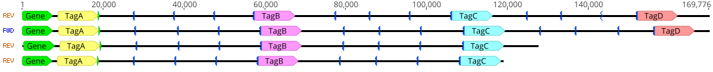

## tagged_longread_assembler
 A snakemake pipeline for assisting assembly of long DNA reads in difficult to assemble regions

### Introduction
Long-read sequencing (Oxford Nanopore MinION, Pacific Biosciences SMRT) has vastly improved our ability to assemble complete genomes.  However, even the longest reported reads from these methods (which extend into megabase lengths) are insufficient to span repeat regions commonly found within eukaryotic genomes, for example 45S gene repeats.  While there are often polymorphisms among repeat copies, the inaccuracy of long-read methods can limit their usefullness for assembly.  This poses a challenge for existing DNA assembly software, which relies primarily on the per-base identity between reads.  However, repeat regions may have structural variants or other identifiable landmarks that are missed by assemblers but contain sufficient information, even within noisy reads, to allow assembly.
This pipeline uses existing tools and custom scripts to generate and polish a consensus sequence with long reads from difficult to assemble regions.  Currently, this tool only assists in the final steps of assembly, relying on the user to identify unique features like structural variants and map them out using scaffolding reads (typically through its sister pipeline `perread_var_call`).  With this user-provided map, `tagged_longread_assembler` gathers reads that contain these unique features and places unique 'sequence tags' into the reads based on their position in the map.  These tags act like anchors in the reads, forcing them to properly align in downstream MSAs and mappings.  Draft sequence is built by parallel MSAs across the entire scaffolded region.  The draft is then polished via multiple rounds of `racon`.

##### Requirements
The pipeline is designed to be run by `snakemake` using its built-in interface with the package manager `conda`.  If needed, install`conda`, then use `conda` to install `snakemake`.  Then, `snakemake` will install all other dependencies when the pipeline is first run with the `--use-conda` option (as below).  Very basic knowledge of `snakemake` usage will be helpful in working with this pipeline.

##### Getting started
```
git clone https://github.com/drfultz/tagged_longread_assembler.git
cd tagged_longread_assembler
touch loci_patterns/test-tel_patterns.tsv
snakemake -j 1 --use-conda final_contigs/test-tel_contig.fa
```
Included in the repository are test inputs and a matching final output that is initially empty.  It will likely take several minutes for `conda` to install all of the dependencies.  It will also take several minutes for the pipeline itself to run.  Upon completion, the initially empty file `final_contigs/test_contig.fa` should be rewritten and should contain a single fasta entry.

### Running your own assembly
In order to run your own assembly, pass your reads through `perread_var_call`.  The resulting feature calls file (.feat) will allow you to create a map of your assembly and run the assembly pipeline

##### Generate the assembly map
Expand this section.
Use `scripts/SV-kmer_simple_count.py` to look for unique loci (based on expected coverage) as starting points, then use `scripts/align_varcall_patterns.py` to explore how these loci connect.

##### Run tagged_longread_assembler
1. Copy the `perread_var_call` outputs, the `.feat` file and the `_oriented.fq` file, into the `tagged_longread_assembler` base directory.
2. Place the names of these files into the appropriate field in the `config.yaml`
3. Place your assembly map into a `_patterns.tsv` in `./loci_patterns/`.  Do this for each contig that you have.
4. From the base directory, run the pipeline for each contig:
	```
	snakemake -j 4 --use-conda final_contigs/YOURLOCI_contig.fa
	```
	
### Pipeline Workflow
Under construction

### Manual tag insertion (for use without `perread_var_call`)
Preparing your input reads manually as fasta or fastq reads containing sequence tags is time consuming and requires careful work.  Essentially, this step is manually mapping out where each individual read segment should be assembled for the pipeline. This can be useful for unusual repeat regions that do not fit the assumptions used in `perread_var_call`. A GUI program for working with DNA sequence is practically necessary.  Geneious works very well, but free alternatives like Genome Compiler, Unipro UGENE, or Benchling's sequence tools could suffice.

1\) The first step for creating an assembly is to find reads from the region.  To do this, define sequence or features that are unique to the region.  Reads containing such a feature can be retrieved by BLAST or minimap2 alignment to the unique sequence.
>For example, a set of tandem repeats of the 45S ribosomal genes in *Arabidopsis thaliana* are bordered on one end by the At4g00005 protein coding gene.  Reads containing this junction are clearly unique to this locus not other 45S loci.  

Less obvious unique features might include structural variants within repeats.  Alignments to a consensus repeat, dot plots against a consensus repeat, and/or automated feature annotations can be useful for identifying such variants.
>For example, in a set of *A. thaliana* 45S repeat reads, annotating reads revealed a region where two tandem repeat units were both truncated in the same manner.  This truncation in two tandem repeats appeared to occur only once in the genome.

2\) Reverse-complement any reads that are in the reverse direction relative to the desired contig.

3\) Now that reads are gathered, plan out where to insert the sequence tags.  (A set of randomly genereated 10kb tags is included in tags/10kb_tags.fasta or generate your own.)  The tags need not be limited to the exact location of unique features but should be placed relative to the locations of unique feature.  For example, 'tag A' could be placed directly upstream of a feature, while 'tag B' could be placed 40 kb downstream of that feature.  These tags must be placed at each of these locations **everytime** that location occurs in a read.

>Using the example of the 45S gene/At4g0005 gene above, tags were placed only at the starts of repeats.  This was done at every fourth repeat after the unique feature. TagA was placed at the gene, TagB was placed at the 4th repeat, TagC at the 8th repeat, and TagD at the 12th repeat, etc.  While the tag positions are all based on one unique feature, having mutltiple tags ensures the inclusion of reads of varying lengths and ensures that the MSA step occurs properly, more quickly, and in parallel.

The order of the tags in the tag fasta file (from top to bottom) needs to match the order of the tags in the expected contig (from left to right).

4\) Insert the tags into the reads using GUI software. To perform the tag insertions using Geneious (Genome Compiler could likely perform similar steps):
- A) View all of the reads in Geneious together (as a Geneious sequence list)
- B) Use the '**Annotate from database**' tool to mark a relatively invariable region of your repeat on all of the reads (this annotation need not be long, 200bp works).  If possible, also annotate your unique feature(s) for clarity.

- C) Copy and paste each tag into the appropriate region on the first read.  Place the tags precisely upstream of each target annotation by clicking on the annotation, then pressing left arrow key followed by right arrow key to position the cursor.  Press **CTRL+V** to paste.  Don't forget to save changes regularly.


- D) Repeat step C) for every read.

5\) Export the Geneious sequence list as a fasta named `{sample_name}_tagreads.fa` and place it in the `tagged_longread_assembler/tagged_reads/` folder.

6\) Set the fasta file containing your sequence tags as the `Tag_set` value in the `config.yaml` file.

7\) From the `tagged_longread_assembler` folder, run `snakemake -j 1 --use-conda final_contigs/{sample_name}_contig.fa` .  If you would like to use parallel threads for each MSA and cons step, set the `-j` value to the desired number of threads.